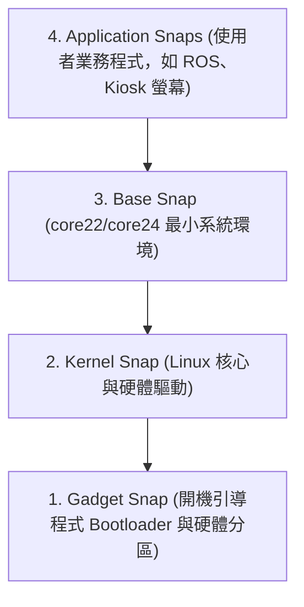

# 01. Canonical Snap 技術全貌與生態體系解析（實戰導向版）

> **官方來源**：
> - 官方首頁：[Snapcraft - The app store for Linux](https://snapcraft.io/)
> - 官方文檔：[Snapcraft Documentation](https://snapcraft.io/docs/)
> - 平台介紹：[About Snapcraft](https://snapcraft.io/about)
> - IoT 與嵌入式專區：[Snaps for IoT & Embedded](https://snapcraft.io/iot)

---

## 前言：為什麼要讀這份指南？

這份指南以觀念說明搭配終端機實作，依序介紹 Snap 的運作原理、核心架構、日常管理指令，以及在 IoT 邊緣裝置上的應用方式。

---

## 第 1 章：什麼是 Snap？為什麼需要它？

### 1.1 【白話說明】從「菜市場買食材」到「微波即食便當盒」

在傳統 Linux 系統中，我們安裝軟體最常用的是 **APT**（例如 `sudo apt install vlc`）：
* **傳統 APT（散裝食材）**：您買了一塊牛排（應用程式），但老闆說家裡還要有特定年份的紅酒、特定廠牌的海鹽（相依函式庫，如 `glibc`、`openssl`）。如果您的廚房版本太舊，牛排就煎不熟；要是強行換掉紅酒，原本能煮的義大利麵可能也跟著壞掉。這就是 Linux 開發者最頭痛的**「Dependency Hell（依賴地獄）」**。
* **Snap（微波即食便當盒）**：Snap 就像一個耐高溫密封的微波便當盒。裡面牛排、醬汁、配菜、叉子**全部打包齊全（Self-contained）**。不管您拿到哪一台微波爐（Ubuntu、Debian、Fedora 或 Arch Linux），撕開加熱就能吃。而且盒子防漏耐壓（**沙盒隔離**），裡面的醬汁絕對不會噴出來弄髒您的廚房系統。

---

### 1.2 【動手實作】看看您電腦上已經有哪些 Snap 便當盒？

在您的 Ubuntu 終端機中，輸入以下指令：

```bash
# 列出目前系統上所有已安裝的 Snap 套件
snap list
```

#### 實機終端機真實輸出範例：
```text
Name                       Version                         Rev    Tracking         Publisher            Notes
bare                       1.0                             5      latest/stable    canonical✓           base
canonical-livepatch        v11.1.0                         418    latest/stable    canonical✓           -
core18                     20260901                        3084   latest/stable    canonical✓           base
core22                     20260909                        2987   latest/stable    canonical✓           base
core24                     20260824                        2124   latest/stable    canonical✓           base
core26                     20260925                        646    latest/stable    canonical✓           base
firefox                    154.0-1                         8763   latest/stable/…  mozilla✓             -
lxd                        6.10.1-f5c750d                  41228  6/stable         canonical✓           -
obsidian                   1.15.0                          72     latest/stable    obsidianmd           classic
snapd                      2.77.1                          28254  latest/stable    canonical✓           snapd
```

#### 實機輸出分析：
1. **多個 Base 版本並存**：
   - 清單中包含 `core18`、`core22`、`core24` 與最新版本的 **`core26`**。
   - 在傳統 APT 中若同時安裝跨世代的底層函式庫容易引發相依衝突；Snap 的 Base 彼此獨立，不同軟體可各自指定相依的系統環境，互不影響。
2. **`Notes` 欄位揭示的權限面貌**：
   - **`obsidian` 標註為 `classic`**：筆記軟體需要自由讀寫硬碟中任意位置的 Markdown 筆記，因此未限制於嚴格沙盒中，享有與傳統本機軟體相同的全系統存取權限。
   - **`firefox` 標註為 `-`（預設 Strict 嚴格沙盒）**：瀏覽器面對外部網路環境，因此被限制在隔離沙盒中，降低惡意網頁威脅宿主機系統的風險。
   - **`base` 標籤**：代表系統基礎環境映像檔。

---

## 第 2 章：Snap 生態四大支柱（它是怎麼運作的？）

### 2.1 【白話說明】Snap 四兄弟的各自分工

整個 Snap 生態由四個核心元件協同運作：


1. **Snap（套件本體）**：密封的便當盒，副檔名為 `.snap` 的壓縮檔。
2. **snapd（核心管家 / 守護行程）**：常駐在背景的服務。當您開機時，是它幫您把便當盒掛載好、排程更新、管理權限。
3. **Snapcraft（打包工具框架）**：開發者使用的命令行工具。寫一份 `snapcraft.yaml` 就能一鍵把原始碼打包成 Snap。
4. **Snap Store（應用商店）**：官方雲端市集，提供搜尋、下載、分發與流量統計。

---

### 2.2 【動手實作】檢查 `snap` 與 `snapd` 系統狀態

讓我們在終端機檢查這套系統的核心狀態：

```bash
# 檢查 snap 與 snapd 的底層版本資訊
snap version
```

#### 實機終端機真實輸出範例：
```text
snap          2.77.1+ubuntu26.04.2
snapd         2.77.1+ubuntu26.04.2
series        16
ubuntu        26.04
kernel        7.0.0-42-generic
architecture  amd64
```

#### 接著查詢遠端商店（Snap Store）上的軟體資訊：
```bash
# 查詢 VLC 播放器在線上市集上的詳細檔案
snap info vlc
```

#### 實機查詢真實輸出範例：
```text
name:      vlc
summary:   The ultimate media player
publisher: VideoLAN✓
...
channels:
  latest/stable:    3.0.24-rc1                  2026-09-22 (4472) 278MB -
  latest/candidate: 3.0.24-rc1                  2026-09-17 (4472) 278MB -
  latest/beta:      3.0.24-53-gc128d1f15c       2026-11-05 (4566) 277MB -
  latest/edge:      4.0.0-dev-39617-gc6d1df39c7 2026-11-05 (4567) 351MB -

_1) Camera and microphone access are required for recording features._
```

#### 實機輸出分析：
1. **預先評估開發中版本**：
   - VLC 在 `latest/stable` 軌道提供穩定版 `3.0.24-rc1`。
   - 而在每日建置的 `latest/edge` 軌道已提供 `4.0.0-dev`。若需測試新版本功能，可直接指定 `--channel=edge` 安裝，不需要手動編譯原始碼。
2. **硬體授權機制的提示**：
   - 輸出的最後一行標示：*「Camera and microphone access are required for recording features」*。
   - 這說明 Snap 預設無法存取相機和麥克風，必須透過後續說明的 **Plugs & Slots 介面機制** 授權。

---

## 第 3 章：底層機制 ── 不解壓縮的「唯讀掛載」

### 3.1 【白話說明】為什麼安裝 Snap 絕不污染系統？揭秘 SquashFS

傳統 `.deb` 安裝軟體時，會把成百上千個檔案「暴力解壓縮」撒進系統的 `/usr/bin`、`/usr/lib` 裡。如果不小心裝了惡意程式或移除不乾淨，殘留檔案就會像垃圾一樣堆滿系統。

**Snap 的做法完全不同：**
1. Snap 本身是一個 **SquashFS 唯讀壓縮映像檔**。
2. 安裝時，系統**「完全不解壓縮」**！
3. 它直接透過 Linux 核心的 Loop Device（虛擬磁碟裝置），把這個檔案像光碟一樣**「掛載（Mount）」**到 `/snap/<軟體名>/<版本號>/`。
4. 應用程式要讀取時，核心即時從壓縮檔解密讀取。軟體想寫入資料時，會被導向專屬的資料目錄（`/var/snap/`），**完全無法污染主機的核心目錄**！

---

### 3.2 【動手實作】親眼看看作業系統是怎麼「掛載」Snap 的

> [!TIP]
> **實務踩坑大揭秘：為什麼剛才打 `df -h` 找不到那堆 Snap？**
> 在早期的 Ubuntu 系統中，每次打 `df -h` 都會被 20 幾個 `/dev/loop0, /dev/loop1...` 的虛擬磁碟嚴重洗版。
> 因此在較新的 Ubuntu 版本中，系統很貼心地**把唯讀虛擬 loop 磁碟在預設的 `df -h` 輸出中隱藏起來了**！
> 要親眼看到它們，請改用更專業的區塊檢視指令 **`lsblk`**，或加上 `-a`（All）參數！

```bash
# 1. 使用區塊裝置樹狀檢視（最推薦，一覽所有 loop 唯讀掛載磁區）
lsblk | grep snap

# 2. 或者使用傳統掛載查詢（加上 -a 強制顯示全部）
df -ah | grep /snap
```

#### 實機終端機真實輸出範例（lsblk）：
```text
loop0    7:0    0  74.3M  1 loop /snap/core22/2987
loop1    7:1    0 266.6M  1 loop /snap/firefox/8763
loop2    7:2    0 110.2M  1 loop /snap/obsidian/72
...
```
> **說明**：每個安裝的 Snap 均為獨立的 Loop 區塊裝置，掛載為唯讀檔案系統。

```bash
# 3. 看看 /snap 根目錄與單一軟體內部是怎麼切換版本的（以 firefox 為例）
ls -l /snap
ls -l /snap/firefox
```

#### 實機輸出範例：
```text
vincent@vincent-ubuntu:~$ ls -l /snap/firefox
drwxr-xr-x 8 root root 4096 Oct 13 19:12 8763
lrwxrwxrwx 1 root root    4 Oct 13 19:12 current -> 8763
```

#### 符號連結架構解析：
1. **`8763`**：這就是剛剛在 `snap list` 看到的 Revision 流水號目錄（唯讀掛載點）。
2. **`current -> 8763`**：這是一個**符號連結（symlink）**。
3. **快速切換與回滾機制**：
   升級時，系統建立新的數字目錄並將 `current` 符號連結指向新目錄；若需回滾，只需將 `current` 重新指向原先的修訂版本目錄即可。

---

## 第 4 章：安全防護網 ── 沙盒隔離與插頭插槽

### 4.1 【白話說明】三大隔離等級（Confinement Levels）

在 Snap 的世界裡，不是所有程式都有權限碰您的電腦：

| 隔離等級 | 白話比喻 | 安全防護特性 | 典型例子 |
| :--- | :--- | :--- | :--- |
| **Strict（嚴格隔離）** | **關在玻璃防護罩裡** | 預設模式。碰不到您的桌面檔案、碰不到麥克風，完全沙盒化。 | 一般工具、網路服務、Nextcloud |
| **Classic（傳統模式）** | **走出玻璃罩的自由人** | 像傳統軟體一樣，能完全讀寫您的系統 `/` 目錄。安裝時需加 `--classic`。 | VS Code、GCC 編譯器、Go 語言 |
| **Devmode（開發者模式）**| **帶著警報器的測試員** | 雖然在沙盒裡，但違規動作只會在後台寫警告 Log，不實際攔截。 | 軟體開發測試階段 |

---

### 4.2 【白話說明】插頭（Plug）與插槽（Slot）：安全開外掛

如果一個被 Strict 嚴格隔離的軟體（例如音樂播放器），需要讀取您的耳機麥克風、或是存取外接隨身碟，該怎麼辦？

Snap 設計了一套極其生動的 **Plugs（插頭）與 Slots（插槽）** 機制：
* **Plug（插頭）**：軟體宣稱「我需要麥克風功能」。
* **Slot（插槽）**：系統核心宣稱「我這裡有麥克風插槽」。
* 只要把插頭插入插槽（`snap connect`），權限就立刻開通！拔掉（`snap disconnect`），權限就立即被收回！

```
[軟體: VLC 播放器]  ──(Plug: audio-record)  ====[ 插入 ]====>  (:audio-record Slot)──> [系統麥克風]
```

---

### 4.3 【動手實作】親手查看與拔插應用程式的權限！

```bash
# 1. 檢視目前系統上所有的介面連線狀態（或針對單一軟體，如 firefox）
snap connections firefox
```

#### 實機真實輸出分析（三大核心設計）：
1. **系統提供者 vs 跨 Snap 共享（冒號的秘密）**：
   - **Slot 開頭有冒號（如 `:camera`、`:network`）**：由 Linux 宿主機系統提供的硬體或系統核心能力。
   - **Slot 開頭無冒號（如 `mesa-2404:gpu-2404`、`gtk-common-themes:gtk-3-themes`）**：**內容共享介面（Content Sharing）**！桌面圖示與 3D 顯示卡驅動由專門的 Snap 提供，其他所有軟體共用，徹底破除 Snap「體積肥大」的迷思！
2. **手動授權標籤（manual）**：
   - 敏感高危權限（如 `nmap:network-control`）預設禁止自動連線，必須使用者親自授權。

---

#### 實作：斷開與重新連線 Firefox 的相機權限

```bash
# 步驟 A：檢查目前 Firefox 的攝影機連線狀態（預設已連線）
snap connections firefox | grep camera
# 輸出：camera  firefox:camera  :camera  -

# 步驟 B：親手把攝影機插頭拔掉（收回硬體權限）
sudo snap disconnect firefox:camera

# 步驟 C：再次檢查，Slot 變成橫槓，攝影機已被物理性阻斷！
snap connections firefox | grep camera
# 輸出：camera  firefox:camera  -        -

# 步驟 D：親手把攝影機插頭插回去
sudo snap connect firefox:camera

# 步驟 E：再次檢查，成功插回，且 Notes 標記變為 manual！
snap connections firefox | grep camera
# 輸出：camera  firefox:camera  :camera  manual
```

> [!TIP]
> **深入底層發現**：最後一行的 Notes 從原本的 `-` 變成了 **`manual`**！
> 這代表系統知道這是使用者「手動指定的意志」，未來就算 Firefox 軟體自動升級，也不會擅自改動您的連線狀態！

---

## 第 5 章：通道機制（Channels）與自動回滾（Rollback）

### 5.1 【白話說明】不用重裝！自由切換穩定版與測試版

在傳統 Linux 中，如果想嘗試某個軟體的 Beta 測試版，往往要手動加 PPA、換軟體源，常常把整個系統搞崩潰。

Snap 內建了**「發行通道（Channels）」**體系，結構為：
`軌道 (Track) / 風險等級 (Risk)`


* **Tracks（軌道）**：代表大版本（例如 Nextcloud 的 `27`、`28`、`latest`）。
* **Risk Levels（風險等級）**：
  - `stable`：經過嚴格測試的正式版。
  - `beta`：功能已開發完畢但可能有些微 Bug。
  - `edge`：每天最新原始碼自動編譯的嘗鮮版。

---

### 5.2 【動手實作】版本切換、資料保留與回滾操作（以 Caddy 為例）

本節採用輕量 Web 伺服器 **`caddy`**，進行端到端的版本切換、資料持久性驗證與回滾操作：

---

#### 步驟 A：安裝穩定版（Rev 708）並在專屬目錄寫入資料
每個 Snap 都有專屬的資料保險箱 `/var/snap/<app>/current/`：

```bash
# 1. 安裝正式穩定版
sudo snap install caddy

# 2. 在 Caddy 專屬目錄寫入資料檔案與 Caddyfile（監聽 8085）
echo "【鐵證】這是 Caddy 在 Rev 708 版本留下的核心資料！" | sudo tee /var/snap/caddy/current/caddy_data.txt

sudo tee /var/snap/caddy/current/Caddyfile << 'EOF'
:8085 {
    root * /var/snap/caddy/current
    file_server
}
EOF

# 3. 在背景啟動 Caddy
sudo caddy start --config /var/snap/caddy/current/Caddyfile

# 4. 用 curl 驗證網頁伺服器有正常回應
curl http://localhost:8085/caddy_data.txt
# 輸出：【鐵證】這是 Caddy 在 Rev 708 版本留下的核心資料！

# 5. 查看當前版本路徑與 Hash
sudo caddy version
# 輸出路徑：_caddy=/snap/caddy/708/usr/bin/caddy
# 輸出 Hash：72dd0fb067f6d7826c7f79907670ba4a713bfe37
```

---

#### 步驟 B：跨通道升級至 edge（Rev 722）── 進程保護機制

```bash
# 1. 停下背景進程（若不停下，Snap 會觸發「Running Apps Protection」拒絕暴力抽換）
sudo caddy stop

# 2. 切換通道至 edge（升級至 Rev 722 / v2.11.8）
sudo snap refresh caddy --channel=edge

# 3. 重新啟動 Caddy
sudo caddy start --config /var/snap/caddy/current/Caddyfile
```

**此時驗證兩項重點：**
```bash
# 1. 版本變更：路徑由 708 變為 722，Hash 亦隨之變更
sudo caddy version
# 輸出路徑：_caddy=/snap/caddy/722/usr/bin/caddy
# 輸出 Hash：55996dfe05c10bb616ccdcc9bf5b8407a5be75b7

# 2. 用 curl 驗證資料：升級後，先前資料已被自動保留並遷移
curl http://localhost:8085/caddy_data.txt
# 輸出：【鐵證】這是 Caddy 在 Rev 708 版本留下的核心資料！
```

---

#### 步驟 C：執行回滾（Rollback）

```bash
# 1. 停下進程並一鍵倒退回穩定版
sudo caddy stop
sudo snap revert caddy
# 輸出：caddy 已恢復到 v2.11.7 (Rev 708)

# 2. 重新啟動
sudo caddy start --config /var/snap/caddy/current/Caddyfile
```

**驗證回滾結果：**
```bash
# 1. 執行檔路徑恢復為 708，程式碼 Hash 與先前一致
sudo caddy version
# 輸出路徑：_caddy=/snap/caddy/708/usr/bin/caddy
# 輸出 Hash：72dd0fb067f6d7826c7f79907670ba4a713bfe37

# 2. curl 存取原先寫入的文字檔，內容與設定依然完整
curl http://localhost:8085/caddy_data.txt
# 輸出：【鐵證】這是 Caddy 在 Rev 708 版本留下的核心資料！
```

---

#### 步驟 D：清理與移除測試環境（零殘留乾淨收尾）

實測完成後，依照標準流程徹底釋放系統資源：

```bash
# 1. 停止 Caddy 背景服務
sudo caddy stop

# 2. 徹底移除 Caddy 套件（加上 --purge 確保連快照備份都不留）
sudo snap remove caddy --purge

# 3. 驗證專屬資料目錄已完全被系統乾淨清空（輸出 No such file or directory）
ls /var/snap/caddy
```

> [!TIP]
> **深入底層發現：為什麼回滾能做到零損壞？**
> 1. **執行檔層面**：舊版的 SquashFS 唯讀映像（Rev 708）從未被刪除，`revert` 只是把 `/snap/caddy/current` 指回 708。
> 2. **資料層面**：`/var/snap/caddy/current` 符號連結同步切回 708 資料夾，讀取當初 708 時期的完整狀態。
> 3. **進程安全保護（Running Apps Protection）**：運作中的程式若未停止，Snap 嚴禁暴力抽換，徹底防範檔案寫入崩潰！

> **想看生產級大型伺服器（Nextcloud 資料庫遷移與非標準 Port）的通道升級？**
> 請參閱專門實戰手冊：[**`02_NEXTCLOUD_SNAP_PRACTICE.md`**](02_NEXTCLOUD_SNAP_PRACTICE.md)。

---

## 第 6 章：為什麼 Snap 是 IoT 與物聯網的命脈？

### 6.1 【白話說明】傳統遠端設備最害怕的「斷電變磚（Bricking）」

想像您部署了 1,000 台智慧充電樁或工廠監控設備在全台灣各地：
* **傳統 APT 升級**：如果更新進行到一半，現場突然跳電、拔掉插頭，或是 4G 網路中斷，檔案只寫入了一半，**整台機器開機直接崩潰（變磚）**！您必須派工程師開車跑遍全台現場拆機重灌，成本極為恐怖。
* **Snap 事務性原子更新（Transactional Updates）**：
  - **All-or-Nothing 原則**：更新是在獨立的新空間進行下載與驗證。未完整寫入並通過健康檢查前，舊系統持續穩定運作。
  - **中斷防護**：若更新過程因斷電或網路中斷而中止，系統下次開機會清除未完成的臨時檔案，並維持原本版本正常運作。

---

### 6.2 【白話說明】省錢神器：Delta 二進位微增量更新

IoT 設備通常使用按傳輸流量計費的 4G/5G SIM 卡或衛星網路。
如果每次小修補都要重新下載幾百 MB 的軟體包，流量費用會非常驚人。

* Snap 支援 **Binary Delta Updates（二進位差分更新）**。
* 雲端 Snap Store 會自動計算新舊版本之間的二進位差分，設備**只下載「發生變動的那幾塊微小積木」**。
* 在最新技術（如 Ubuntu Core 的 `snap-delta`）中，OTA 更新流量**能直接節省 50% 至 90%**（底層基礎更新甚至能縮小至 1.5 MB 左右）！

---

### 6.3 【白話說明】Ubuntu Core：100% 全 Snap 的不可變作業系統

Canonical 專為物聯網打造的 **Ubuntu Core** 作業系統中，傳統的 `apt` 完全被廢除，整台電腦從頭到腳全由 Snap 組裝而成：



1. **Gadget Snap**：管開機載入器（GRUB / U-Boot）與主機板腳位定義。
2. **Kernel Snap**：管 Linux 核心與專屬硬體驅動。
3. **Base Snap**：提供最小根系統。
4. **App Snap**：您的業務應用（如攝影機辨識、資料上傳）。

整個系統底層都是**唯讀（Read-Only）**，惡意駭客完全無法篡改系統檔案，實現最高等級的工業級安全防護。

---

### 6.4 【動手實作】檢視系統更新的「事務歷史紀錄（Changes）」與原子狀態機

Snap 背景管家做過的每一件事，都有完整的不可篡改歷史交易紀錄：

```bash
# 1. 檢視系統變更歷程
snap changes
```

#### 實機真實輸出範例（今日所有操作全被完整記錄）：
```text
ID   Status  Spawn               Ready               Summary
42   Done    today at 15:41 CST  today at 15:42 CST  Install "nextcloud" snap from "27/stable" channel
45   Done    today at 20:22 CST  today at 20:23 CST  Refresh "nextcloud" snap from "28/stable" channel
46   Done    today at 20:25 CST  today at 20:25 CST  Revert "nextcloud" snap
47   Done    today at 20:27 CST  today at 20:28 CST  Remove "nextcloud" snap
48   Done    today at 20:29 CST  today at 20:29 CST  Forget of snapshot set #5
51   Done    today at 20:50 CST  today at 20:50 CST  Disconnect : from firefox:camera
52   Done    today at 20:50 CST  today at 20:50 CST  Connect firefox:camera to snapd:camera
56   Done    today at 21:01 CST  today at 21:01 CST  Install "caddy" snap
57   Done    today at 21:09 CST  today at 21:09 CST  Refresh "caddy" snap from "edge" channel
58   Done    today at 21:10 CST  today at 21:10 CST  Revert "caddy" snap
59   Done    today at 21:13 CST  today at 21:13 CST  Remove "caddy" snap
```

---

#### 檢視回滾背後的執行步驟

```bash
# 2. 深入查詢特定動作（例如 ID 58 的 Revert caddy）的底層微任務清單
snap tasks 58
```

#### 實機拆解輸出：
```text
Status  Spawn               Ready               Summary
Done    today at 21:10 CST  today at 21:10 CST  Ensure prerequisites for "caddy" are available
Done    today at 21:10 CST  today at 21:10 CST  Prepare snap "" (708)
Done    today at 21:10 CST  today at 21:10 CST  Stop snap "caddy" services
Done    today at 21:10 CST  today at 21:10 CST  Make current revision for snap "caddy" unavailable
Done    today at 21:10 CST  today at 21:10 CST  Prepare snap "caddy" (708) for security profile setup
Done    today at 21:10 CST  today at 21:10 CST  Make snap "caddy" (708) available to the system
Done    today at 21:10 CST  today at 21:10 CST  Automatically connect eligible plugs and slots of snap "caddy"
Done    today at 21:10 CST  today at 21:10 CST  Start snap "caddy" (708) services
Done    today at 21:10 CST  today at 21:10 CST  Run health check of "caddy" snap
Done    today at 21:10 CST  today at 21:10 CST  Setup snap "caddy" (708) security profiles
```

> [!IMPORTANT]
> **為什麼 IoT 設備絕不變磚？這就是答案：**
> 一次簡單的 `snap revert`，底層是一套嚴密的**原子狀態機（Atomic State Machine）**！
> 它必須逐一通過「停止服務 ➜ 下線新版 ➜ 掛載舊版 708 ➜ 重新接上 Plugs/Slots ➜ 執行健康檢查（Health Check）➜ 重建安全策略」。
> 只要其中任何一步卡住或失敗，整套狀態機**瞬間全盤倒退回原樣**，絕不留任何半吊子或開不了機的殘缺狀態！

---

### 6.5 【動手實作】走進純 Snap 不可變世界 ── Ubuntu Core 虛擬機親手實證（Multipass 避坑指南）

如果您想親眼看看「整個作業系統 100% 全由 Snap 堆砌、完全沒有 APT、根目錄唯讀不可變」的工業物聯網世界，可以使用 Canonical 官方的 **`multipass`** 一鍵啟動虛擬機：

```bash
# 1. 安裝 Multipass
sudo snap install multipass

# 2. 刷新遠端倉庫索引（避坑必做）
multipass find --force-update
```

> [!CAUTION]
> **映像檔名稱避坑重點（必須加 `core:` 前綴）**：
> 在 `multipass find` 中，Ubuntu Core 屬於專門的 `core` 遠端倉庫，因此名稱必須帶有前綴 **`core:core22`** 或 **`core:core24`**。若只打 `core22`，系統會報錯找不到映像檔！

```bash
# 3. 啟動 Ubuntu Core 虛擬機（名稱取叫 my-core）
multipass launch core:core22 --name my-core

# 4. 直接進入 Ubuntu Core 終端機內部
multipass shell my-core
```

---

#### 登入驗證重點：

登入時，官方系統歡迎標語（MOTD）便會宣告：
> *「This Ubuntu Core 22 machine is a tiny, transactional edition of Ubuntu, designed for appliances, firmware and fixed-function VMs. ... It's a brave new world here in Ubuntu Core!」*

```bash
# 震撼 1：傳統的 APT 套件庫被完全拔除！
ubuntu@my-core:~$ apt
# 輸出：-bash: apt: command not found

# 震撼 2：整台作業系統 100% 只有 4 個 Snap 積木！
ubuntu@my-core:~$ snap list
```
#### 實機清單輸出：
```text
Name       Version         Rev    Tracking       Publisher    Notes
core22     20230703        817    latest/stable  canonical✓  base
pc         22-0.3          146    22/stable      canonical✓  gadget
pc-kernel  5.15.0-76.83.1  1321   22/stable      canonical✓  kernel
snapd      2.59.5          19457  latest/stable  canonical✓  snapd
```
- **`pc`（gadget）**：連 BIOS / GRUB 開機引導程式與硬體分區都是 Snap！
- **`pc-kernel`（kernel）**：連 Linux 核心與硬體驅動程式都是 Snap！
- **`core22`（base）**：最小根系統。
- **`snapd`（snapd）**：守護管家。整台電腦除此以外空無一物，極致輕量與純粹！

```bash
# 震撼 3：工業級不可變唯讀系統（Immutable Rootfs）
ubuntu@my-core:~$ sudo touch /usr/bin/test_hacker
# 輸出：touch: cannot touch '/usr/bin/test_hacker': Read-only file system
```
> **安全核心**：即使攻擊者取得 `root` 權限，整個核心檔案系統也是**唯讀（Read-only）**，絕對無法寫入木馬或篡改二進位檔案！

---

#### 步驟 5：測試完畢退回主機並銷毀虛擬機
```bash
# 1. 退出虛擬機回到主機
exit

# 2. 徹底銷毀虛擬機（釋放磁碟空間）
multipass delete my-core --purge
```

---

## 第 7 章：殘留快照清理（Snapshots）與完全卸載

### 7.1 【白話說明】為什麼移除軟體後空間沒有完全釋放？

許多人會發現：「我剛才打了 `sudo snap remove nextcloud`，為什麼硬碟空間感覺沒變大？」
請看終端機印出的訊息：
> `nextcloud removed (snap data snapshot saved)`

這是 Snap 的貼心防呆機制！它怕您是不小心手殘刪錯軟體，所以在移除的同時，自動把該軟體的資料庫與設定打包成一份壓縮檔保存在系統中。

---

### 7.2 【動手實作】查詢快照與徹底銷毀殘留

```bash
# 1. 查詢目前系統中保留的所有快照
snap saved
```

#### 終端機輸出範例：
```text
Set  Snap       Age    Version       Rev    Size    Notes
5    nextcloud  2m     27.1.11snap1  44288  46.4MB  auto
```

```bash
# 2. 徹底銷毀該快照，100% 釋放空間（將 5 換成您實際看到的 Set 編號）
sudo snap forget 5
```

終端機回應 `Snapshot #5 forgotten.`，此時殘留資料徹底被抹除，達到真正的 100% 零殘留！

> **快速訣竅**：如果下次要移除軟體且**一開始就完全不要留備份**，直接下：
> ```bash
> sudo snap remove <軟體名> --purge
> ```

---

## 第 8 章：四大主流交付技術橫向對照（我該選誰？）

| 比較維度 | Canonical Snap | Flatpak | Docker / Podman | APT (`.deb`) |
| :--- | :--- | :--- | :--- | :--- |
| **主要戰場** | **全能型**：桌面、伺服器後台、IoT 邊緣系統 | **專注桌面**：個人電腦圖形應用（Desktop GUI） | **雲端微服務**：伺服器容器與後端 API | **作業系統底層**：Linux 核心與原生系統組件 |
| **系統後台服務 (Daemons)** | **原生完整支援**（systemd 自動開機管理） | **完全不支援**（專門做桌面視窗軟體） | 原生支援（需搭配容器編排或守護服務） | 原生完整支援 |
| **安全沙盒隔離** | 內建 AppArmor + Seccomp + Namespaces | 內建 Bubblewrap + Flatpak Portals | cgroups + Namespaces 容器隔離 | 無沙盒（以 root 或當前使用者直接跑） |
| **更新機制** | 事務性原子更新、Delta 增量、自動回滾 | 支援 OSTree 增量與原子更新 | 拉取全新 Image 替換容器 | 循序檔案覆蓋，中斷容易損毀 |
| **最適合什麼人？** | 需要一鍵佈署全套伺服器服務、維運 Ubuntu Core / IoT 邊緣設備的團隊 | 想在個人電腦上輕鬆裝 Steam、Spotify、Discord 聽歌打遊戲的 Linux 玩家 | 雲原生微服務開發者、K8s 維運工程師 | 需要追求極限輕量、客製化編譯底層系統的極客 |

---

## 第 9 章：系統容錯與高可用驗證：如果 snap 服務故障，所有套件都會癱瘓嗎？

### 9.1 【架構核心解析】Control Plane（控制平面）與 Data Plane（執行平面）的徹底解耦

很多人在學習 Snap 時會有一個直覺誤解：「所有 Snap 套件是不是都跑在 `snapd` 裡面？如果 `snapd` 守護行程當機或掛掉，我的網站、資料庫與桌面程式是不是會全軍覆沒？」

**答案是：絕對不會！絕大多數已在運行的 Snap 套件與服務，依然會 100% 正常運作，毫髮無傷！**

這背後的關鍵架構，正是現代分散式系統極為講究的**控制平面與執行平面分離**：

```
       【管理與控制平面 (Control Plane)】
         snapd (守護行程) + snapd.socket (通訊端)
          │  (僅負責：套件下載、驗證簽章、排程更新、產生設定檔)
          ▼
   ┌────────────────────────────────────────────────────────┐
   │                  Linux 作業系統核心 (Kernel)              │
   │                                                        │
   │  【執行與數據平面 (Data / Runtime Plane)】                │
   │  1. 服務監管：由 Linux 核心與 systemd (PID 1) 原生直接管轄│
   │  2. 安全隔離：AppArmor 規則已直接載入核心記憶體中持續防禦 │
   │  3. 檔案掛載：唯讀 SquashFS 已直接掛載至核心 VFS          │
   └────────────────────────────────────────────────────────┘
          │
          ├─► Nextcloud / Caddy (背景服務：正常連線、完全無感)
          ├─► LXD 叢集與其託管的虛擬容器 (正常運算、網路不中斷)
          └─► 桌面應用 (Firefox, Obsidian：介面不閃退、操作如常)
```

1. **`snapd` 只是「行政管家」，不是「發電機」**：
   - `snapd` 只負責靜態配置（下載 Snap、掛載 SquashFS、生成 AppArmor 安全設定檔、向系統註冊 systemd 服務）。
   - 一旦軟體跑起來，`snapd` 就完全退居幕後，不再經手任何網路流量與運算資料。
2. **服務直接交給 Linux 系統的 `systemd`（PID 1）接管**：
   - Snap 裡的 Daemon（後台守護行程）實際上是直接以原生的 `.service` 形式掛在 Linux 核心的 `systemd` 底下（例如 `snap.lxd.daemon.service`）。它的生命週期是由 Linux 系統維持，根本不依賴 `snapd`。
3. **安全沙盒直接寫在 Linux 核心記憶體中**：
   - AppArmor 和 Seccomp 的過濾規則早在程式啟動瞬間就已注入 Linux 核心。即使 `snapd` 行程完全被終止，核心依然恪盡職守地執行隔離限制。

---

### 9.2 【實機極限測試】暴力終止 snapd 服務，檢驗線上運行進程

我們在實際的 Ubuntu 主機上，以正在運行大型虛擬化叢集（**LXD**）與 **3 個活躍容器**的生產級環境，進行暴力破壞與容錯驗證：

#### 步驟 1：檢視當前運行的服務與其 PID（Process ID，行程識別碼）
```bash
vincent@vincent-ubuntu:~$ ps aux | grep -i lxd
```
**終端機實際輸出：**
```text
root        6948  ... /bin/sh /snap/lxd/41228/commands/daemon.start
root        7392  ... lxcfs /var/snap/lxd/common/var/lib/lxcfs -p /var/snap/lxd/common/lxcfs.pid
root        7697  ... lxd --logfile /var/snap/lxd/common/lxd/logs/lxd.log --group lxd
lxd         8009  ... dnsmasq ... --interface=lxdbr0 ...
root        8084  ... [lxc monitor] /var/snap/lxd/common/lxd/containers node-20
root        8147  ... [lxc monitor] /var/snap/lxd/common/lxd/containers node-24
root       17804  ... [lxc monitor] /var/snap/lxd/common/lxd/containers mgmt-node
```
> 請記住核心進程的 PID：LXD 為 **`7697`**，底下的容器分別為 **`8084`**、**`8147`**、**`17804`**。

#### 步驟 2：手動強制停止 `snapd` 服務與其 Socket 通訊端
```bash
sudo systemctl stop snapd.service snapd.socket
```

#### 步驟 3：測試 CLI 管理指令（觀察管家失聯現象）
```bash
vincent@vincent-ubuntu:~$ snap list
^C
```
- **現象剖析**：終端機卡住，直到手動按下 `Ctrl + C`（`^C`）。
- **背後原理**：當 `/run/snapd.socket` 斷開時，`snap` CLI 指令具備內建的 **Wait & Retry（重試等待）** 防禦機制，它不會立刻崩潰報錯，而是會耐心等待管家重新啟動；在超時（Timeout）之前若手動中斷即會退出。

#### 步驟 4：再次檢查 LXD 伺服器與 3 個容器的存活狀態
```bash
vincent@vincent-ubuntu:~$ ps aux | grep -i lxd
```
**終端機實際輸出：**
```text
root        6948  ... /bin/sh /snap/lxd/41228/commands/daemon.start
root        7392  ... lxcfs /var/snap/lxd/common/var/lib/lxcfs -p /var/snap/lxd/common/lxcfs.pid
root        7697  ... lxd --logfile /var/snap/lxd/common/lxd/logs/lxd.log --group lxd
lxd         8009  ... dnsmasq ... --interface=lxdbr0 ...
root        8084  ... [lxc monitor] /var/snap/lxd/common/lxd/containers node-20
root        8147  ... [lxc monitor] /var/snap/lxd/common/lxd/containers node-24
root       17804  ... [lxc monitor] /var/snap/lxd/common/lxd/containers mgmt-node
```
> 震撼性的驗證結果：**所有的 PID（`7697`、`8009`、`8084`、`8147`、`17804`）完全沒有改變！**
> 這代表即使管理平台 `snapd` 徹底停止，底層正在運算與提供服務的虛擬機、容器叢集**連 1 毫秒都沒有重啟或中斷**！

#### 步驟 5：重新喚醒 snapd 服務並驗證無縫接軌
```bash
sudo systemctl start snapd.socket snapd.service
snap list
```
終端機立刻正常列出所有套件列表，整個系統無縫恢復管理狀態。

---

### 9.3 故障時究竟會影響什麼？（衝擊面評估）

| 系統維度 | 運作狀態 | 具體影響與說明 |
| :--- | :---: | :--- |
| **已運行的服務與容器** | **正常運作** | Web 伺服器、資料庫、LXD 容器連線完全不斷線。 |
| **正在使用的桌面應用** | **正常運作** | Firefox 網頁依然可瀏覽，桌面視窗完全不會閃退。 |
| **CLI 管理指令** | **暫時停擺** | 無法執行 `snap install`、`refresh`、`remove` 等操作。 |
| **自動更新排程** | **暫時中斷** | 不會檢查最新版本或下載 Delta 增量檔案，直至服務重啟。 |
| **新啟動特定桌面應用** | **可能延遲** | 少數桌面軟體初次啟動若需向 `snapd` 協商 Desktop Portal 動態權限，可能受阻。 |

---

### 9.4 【架構對比】Snap vs Docker 的容錯哲學

- **Docker（預設情況）**：
  在傳統容器配置中，Container 進程往往高度相依於 `dockerd` 及其子行程鏈。若 `dockerd` 崩潰且未事先配置 `live-restore: true`，所有容器的標準輸入輸出流可能中斷，甚至引發容器連帶退出重啟。
- **Snap**：
  架構上直接擁抱「原生 Linux 系統服務」。Snap 只是應用程式的**標準化包裝箱與沙盒規格**；一旦進程由 systemd 拉起，它本質上就是獨立的 Linux 原生進程。這使得管理維護者在進行 `snapd` 核心引擎升級時，享有真正的 **Zero Downtime（零停機時間）** 信心保證。
