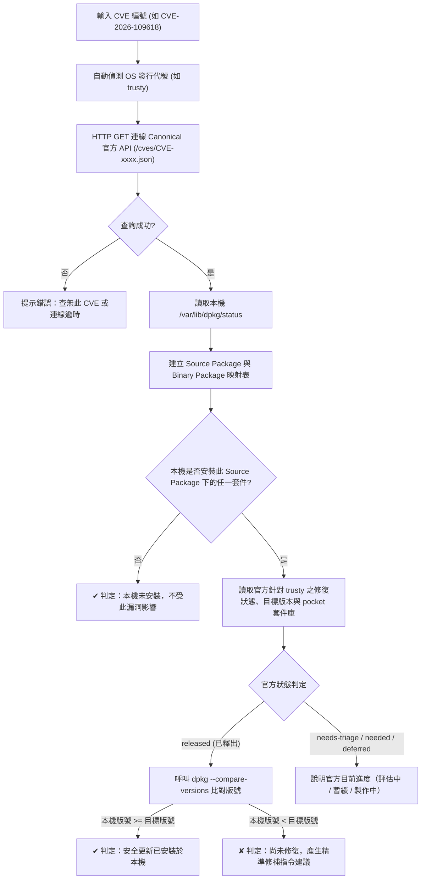

# profix.sh — Ubuntu 舊版 CVE 快速診斷工具使用指南

> **僅供學習參考、使用風險自負。本工具為個人學習與排查參考腳本，非 Canonical 官方發布之正式工具。**

---

## 一、為什麼要開發 profix.sh？(Background & Motivation)

### 1. 舊版發行版缺乏官方 `pro fix` 的核心痛點
在現代 Ubuntu（20.04 LTS、22.04 LTS、24.04 LTS+）中，Canonical 官方提供的 `ubuntu-pro-client` 具備強大的 `pro fix <CVE-編號>` 指令，系統管理員能在命令列終端機中，釐清某個 CVE 漏洞是否影響本機、官方是否已釋出修復、修復套件名稱與目標版號，並取得修補指引。

然而，在長青維運的舊版系統中（例如 **Ubuntu 14.04 LTS Trusty Tahr**）：
- 系統僅內建早期版本的 `ubuntu-advantage-tools`（指令為 `ua`，多為 19.x 或更早版本）。
- 官方未將包含 `pro fix` 功能的現代 Pro Client 回移植（backport）至 Ubuntu 14.04。
- 舊版 `ua` 工具僅支援訂閱附掛（attach）與基本服務啟用（如 `ua enable esm-infra`），並未提供單筆 CVE 的診斷命令。

### 2. 傳統人工排查的低效與繁瑣
在缺乏 `pro fix` 的情況下，若要排查特定 CVE，維運人員往往需要手動進行多步驟比對：
1. 開啟瀏覽器或以 `curl` 查閱 Canonical 官方資安公告與 Tracker 頁面。
2. 搜尋目標發行版代號（如 `trusty`）對應的來源套件（Source Package）名稱、所屬套件庫（pocket）與目標修補版號。
3. 登入主機透過 `dpkg -l` 查詢本機實際安裝的二進位套件（Binary Package）名稱與現行版本。
4. 人工比對版號字串——Debian/Ubuntu 的版號規格包含 epoch（紀元）、上游版號、Debian 修訂版號與 Ubuntu 特有修補版號（如 `esm` 後綴），人工判讀較易耗時。

### 3. 工具定位
為了解決上述手動查詢的繁瑣，本專案編寫了 `profix.sh`，作為個人學習與舊版環境排查的輔助腳本：
- **排版對齊**：參考現代官方 `pro fix` 的終端機回饋樣式與排版語意，以繁體中文呈現。
- **即時連線**：連線 Canonical 官方公開資安 REST API，取得漏洞與套件庫資訊。
- **本地比對**：由本機 `/var/lib/dpkg/status` 解析來源套件關聯，並透過系統原生 `dpkg --compare-versions` 判定版號狀態。
- **修補指引**：依據 API 回傳的套件庫（pocket）欄位，自動生成對應的 `sudo ua enable <pocket>` 與 `--only-upgrade` 精確修復指令。

---

## 二、使用先決條件與情境限制 (Prerequisites & Constraints)

### 1. 先決條件 (Prerequisites)
`profix.sh` 採極簡與零第三方依賴設計，只要受測環境符合以下基本要求即可直接執行：

1. **網路連線能力**：
   - 受測主機能連線至 Canonical 官方資安 API：`https://ubuntu.com/security/cves/<CVE>.json`（通訊埠 Port 443 HTTPS）。
2. **HTTP 下載工具**：
   - 系統已安裝 `curl` 或 `wget`（腳本會自動偵測並選用可用者）。
3. **Python 直譯器**：
   - 系統存在 `python3` 或 `python`（Python 2.7+ 均相容）。僅使用標準函式庫（`json`、`sys`、`subprocess`、`io`、`re`），無須安裝任何 pip 套件。
4. **Debian 套件管理基底**：
   - 具備 `dpkg` 與 `/var/lib/dpkg/status` 檔案（Ubuntu 系統預設皆已具備，一般使用者權限即可唯讀存取）。

### 2. 情境限制與注意事項 (Situational Constraints)

> [!WARNING]
> **限制與邊界說明**
>
> 1. **僅限官方來源套件**：
>    `profix.sh` 是以 Canonical 官方資安資料庫為比對依據。非經由 Ubuntu 官方套件庫安裝之軟體（例如自行從原始碼編譯 `make install`、第三方 PPA、獨立下載的 `.deb` 檔或非官方容器內部的二進位檔），無法透過此工具診斷。
> 2. **純唯讀檢查工具，不變更系統**：
>    腳本只負責比對與給予建議，**不會私自變更系統狀態或主動升級套件**。若需套用修復，請手動複製腳本最後產出的修補指令執行。
> 3. **ESM 授權與套件庫相依**：
>    若診斷結果顯示修補位於 `esm-infra-legacy` 或 `esm-infra` 等 Pro 套件庫，本機必須已綁定有效的 ESM / Pro 授權，後續執行 `apt-get install` 才能成功下載該修補套件。
> 4. **API 查詢頻率與安全上限（30 筆）**：
>    本工具支援以空格分隔一口氣傳入多筆 CVE。為避免短時間密集連線觸發 Canonical 官方資安 API 限流（Rate Limit），腳本內建單次查詢安全上限為 **30 筆**，且每筆查詢之間會自動加入微小間隔保護網路狀態。若超過上限，腳本會提示中斷並建議分批執行。

---

## 三、使用方式與語法 (Usage & Syntax)

### 1. 檔案位置與執行權限
確保腳本具備執行權限（或直接使用 `bash` 調用）：
```bash
chmod +x profix.sh
```

### 2. 基本語法
支援單筆或以空格分隔一口氣傳入多筆 CVE，且 `--dry-run` 放置前後均可：
```bash
# 單筆 CVE 診斷
bash profix.sh <CVE-編號>

# 多筆 CVE 批次診斷（以空格分隔）
bash profix.sh <CVE-1> <CVE-2> <CVE-3> ...

# 模擬執行模式
bash profix.sh --dry-run <CVE-1> <CVE-2>
bash profix.sh <CVE-1> <CVE-2> --dry-run
```

> [!NOTE]
> **關於 `--dry-run` 參數說明**：
> 本工具本質上僅進行唯讀診斷與比對，全程均不會安裝、升級或變更系統上的任何套件。傳入 `--dry-run` 參數主要是為了對齊官方 `pro fix` 的提示訊息格式與終端機習慣。

### 3. CVE 編號格式彈性支援
腳本內建正規化防呆機制，下列寫法均能自動識別並轉為標準大寫 `CVE-YYYY-NNNNN`：
- `CVE-2026-109618`
- `cve-2026-109618`
- `2026-109618`

---

## 四、診斷流程與底層比對架構 (Architecture)



---

## 五、執行範例與輸出解析 (Examples & Walkthrough)

### 範例 1：本機未受影響（未安裝該套件，實機測試）
當本機未安裝該漏洞所牽涉的套件時（例如查詢未安裝的 `less` 套件弱點）：

```bash
bash profix.sh CVE-2024-32487
```

**輸出結果**：
```text
CVE-2024-32487: less vulnerabilities
 - https://ubuntu.com/security/CVE-2024-32487
 - 官方安全公告: USN-6744-1

本機未安裝任何受影響的來源套件（Source Package）。

✔ CVE-2024-32487 不影響您的系統。
```

---

### 範例 2：已安裝套件且受漏洞影響（需修補，實機測試）
以 Ubuntu 14.04 上的重大 PHP 遠端程式碼執行漏洞（CVE-2026-109618）為例，本機安裝了未修補之 `php5`：

```bash
bash profix.sh CVE-2026-109618
```

**輸出結果**：
```text
CVE-2026-109618: out-of-memory handling can interrupt PHP while internal request data is only partially initialized.
 - https://ubuntu.com/security/CVE-2026-109618
 - 官方安全公告: USN-8948-1, USN-8948-2

本機已安裝 1 個受影響的來源套件: php5
(1/1) php5:
官方修復已於 Ubuntu Pro Legacy 支援套件庫（esm-infra-legacy） 中提供。
官方目標修復版號: 5.5.9+dfsg-1ubuntu4.29+esm18
該安全更新尚未安裝。目前本機安裝之套件:
  - php5-cli (5.5.9+dfsg-1ubuntu4.29)
  - php5-common (5.5.9+dfsg-1ubuntu4.29)
  - php5-readline (5.5.9+dfsg-1ubuntu4.29)

仍有 1 個套件受此漏洞影響: php5

若要在 Ubuntu trusty 上套用修復，請依序執行:
  sudo ua enable esm-infra-legacy
  sudo apt-get update
  sudo apt install --only-upgrade php5-cli php5-common php5-readline

✘ CVE-2026-109618 尚未修復。
```

> [!TIP]
> **修補指令解析**：
> 腳本透過官方 API 的 `pocket` 欄位精準判定該修復位於 `esm-infra-legacy`，因此產出 `sudo ua enable esm-infra-legacy` 指令，並搭配 `--only-upgrade` 僅針對已安裝的二進位套件執行升級。

---

### 範例 3：修補已安裝完成（示意輸出，未實測，因無 Pro 授權）

> [!NOTE]
> **示意輸出，未實測（沒有 Pro 授權）**：
> 若持有有效之 Pro 授權並透過上述指令完成套件升級後，再次執行 `profix.sh` 進行覆核的預期文字回饋示意：

```bash
bash profix.sh CVE-2026-109618
```

**預期輸出結果**：
```text
CVE-2026-109618: out-of-memory handling can interrupt PHP while internal request data is only partially initialized.
 - https://ubuntu.com/security/CVE-2026-109618
 - 官方安全公告: USN-8948-1, USN-8948-2

本機已安裝 1 個受影響的來源套件: php5
(1/1) php5:
官方修復已於 Ubuntu Pro Legacy 支援套件庫（esm-infra-legacy） 中提供。
該安全更新已安裝於本機。目前安裝之套件:
  - php5-cli (5.5.9+dfsg-1ubuntu4.29+esm18)
  - php5-common (5.5.9+dfsg-1ubuntu4.29+esm18)
  - php5-readline (5.5.9+dfsg-1ubuntu4.29+esm18)

✔ CVE-2026-109618 已修復完畢。
```

---

### 範例 4：使用 `--dry-run` 模擬模式（實機測試）
執行時帶有 `--dry-run` 參數，頂部會顯示標準提示訊息：

```bash
bash profix.sh --dry-run CVE-2026-109619
```

**輸出結果**：
```text
警告：目前正使用 --dry-run 模擬執行模式。
執行此指令時不會安裝或變更系統上的任何套件。

CVE-2026-109619: request-owned internal state can survive after its backing memory has been freed.
 - https://ubuntu.com/security/CVE-2026-109619
 - 官方安全公告: USN-8948-1, USN-8948-2

本機已安裝 1 個受影響的來源套件: php5
(1/1) php5:
官方修復已於 Ubuntu Pro Legacy 支援套件庫（esm-infra-legacy） 中提供。
官方目標修復版號: 5.5.9+dfsg-1ubuntu4.29+esm18
該安全更新尚未安裝。目前本機安裝之套件:
  - php5-cli (5.5.9+dfsg-1ubuntu4.29)
  - php5-common (5.5.9+dfsg-1ubuntu4.29)
  - php5-readline (5.5.9+dfsg-1ubuntu4.29)

仍有 1 個套件受此漏洞影響: php5

若要在 Ubuntu trusty 上套用修復，請依序執行:
  sudo ua enable esm-infra-legacy
  sudo apt-get update
  sudo apt install --only-upgrade php5-cli php5-common php5-readline

✘ CVE-2026-109619 尚未修復。
```

---

### 範例 5：官方尚在評估中或尚未釋出修補
若遇到較新或官方尚未釋出補丁的 CVE：

```text
CVE-2026-XXXXX: Sample Package Vulnerability
 - https://ubuntu.com/security/CVE-2026-XXXXX

本機已安裝 1 個受影響的來源套件: libssl
(1/1) libssl:
Ubuntu 資安工程師目前正在調查此漏洞。

仍有 1 個套件受此漏洞影響: libssl

✘ CVE-2026-XXXXX 尚未修復。
```

---

### 範例 6：一次輸入多筆 CVE 批次診斷（含總結摘要，實機測試）
在未綁定 Pro 授權的 Ubuntu 14.04 實體環境中，單一指令輸入 3 筆 CVE，腳本會依序診斷並在最下方輸出統整摘要：

```bash
bash profix.sh --dry-run CVE-2026-109618 CVE-2026-109619 2026-8376
```

**輸出結果**：
```text
警告：目前正使用 --dry-run 模擬執行模式。
執行此指令時不會安裝或變更系統上的任何套件。

================================================================================
[1/3] 正在檢測: CVE-2026-109618
================================================================================
CVE-2026-109618: out-of-memory handling can interrupt PHP while internal request data is only partially initialized.
 - https://ubuntu.com/security/CVE-2026-109618
 - 官方安全公告: USN-8948-1, USN-8948-2

本機已安裝 1 個受影響的來源套件: php5
(1/1) php5:
官方修復已於 Ubuntu Pro Legacy 支援套件庫（esm-infra-legacy） 中提供。
官方目標修復版號: 5.5.9+dfsg-1ubuntu4.29+esm18
該安全更新尚未安裝。目前本機安裝之套件:
  - php5-cli (5.5.9+dfsg-1ubuntu4.29)
  - php5-common (5.5.9+dfsg-1ubuntu4.29)
  - php5-readline (5.5.9+dfsg-1ubuntu4.29)

仍有 1 個套件受此漏洞影響: php5

若要在 Ubuntu trusty 上套用修復，請依序執行:
  sudo ua enable esm-infra-legacy
  sudo apt-get update
  sudo apt install --only-upgrade php5-cli php5-common php5-readline

✘ CVE-2026-109618 尚未修復。

================================================================================
[2/3] 正在檢測: CVE-2026-109619
================================================================================
CVE-2026-109619: request-owned internal state can survive after its backing memory has been freed.
 - https://ubuntu.com/security/CVE-2026-109619
 - 官方安全公告: USN-8948-1, USN-8948-2

本機已安裝 1 個受影響的來源套件: php5
(1/1) php5:
官方修復已於 Ubuntu Pro Legacy 支援套件庫（esm-infra-legacy） 中提供。
官方目標修復版號: 5.5.9+dfsg-1ubuntu4.29+esm18
該安全更新尚未安裝。目前本機安裝之套件:
  - php5-cli (5.5.9+dfsg-1ubuntu4.29)
  - php5-common (5.5.9+dfsg-1ubuntu4.29)
  - php5-readline (5.5.9+dfsg-1ubuntu4.29)

仍有 1 個套件受此漏洞影響: php5

若要在 Ubuntu trusty 上套用修復，請依序執行:
  sudo ua enable esm-infra-legacy
  sudo apt-get update
  sudo apt install --only-upgrade php5-cli php5-common php5-readline

✘ CVE-2026-109619 尚未修復。

================================================================================
[3/3] 正在檢測: CVE-2026-8376
================================================================================
CVE-2026-8376: Perl versions before 5.40.5-RC1, from 5.41.0 before 5.42.3-RC1, from 5.43.0 before 5.43.11 have a heap buffer overflow when compiling regular expressions with a repeated fixed string on 32-bit builds
 - https://ubuntu.com/security/CVE-2026-8376
 - 官方安全公告: USN-8467-1, USN-8467-2

本機已安裝 1 個受影響的來源套件: perl
(1/1) perl:
官方修復已於 Ubuntu Pro Legacy 支援套件庫（esm-infra-legacy） 中提供。
官方目標修復版號: 5.18.2-2ubuntu1.7+esm7
該安全更新尚未安裝。目前本機安裝之套件:
  - perl (5.18.2-2ubuntu1.7)
  - perl-base (5.18.2-2ubuntu1.7)
  - perl-modules (5.18.2-2ubuntu1.7)

仍有 1 個套件受此漏洞影響: perl

若要在 Ubuntu trusty 上套用修復，請依序執行:
  sudo ua enable esm-infra-legacy
  sudo apt-get update
  sudo apt install --only-upgrade perl perl-base perl-modules

✘ CVE-2026-8376 尚未修復。

================================================================================
【診斷總結摘要】共檢查 3 筆 CVE
================================================================================
  ✔ 安全 / 已修復完畢：0 筆
  ✘ 尚未修復（需更新）：3 筆
================================================================================
```
